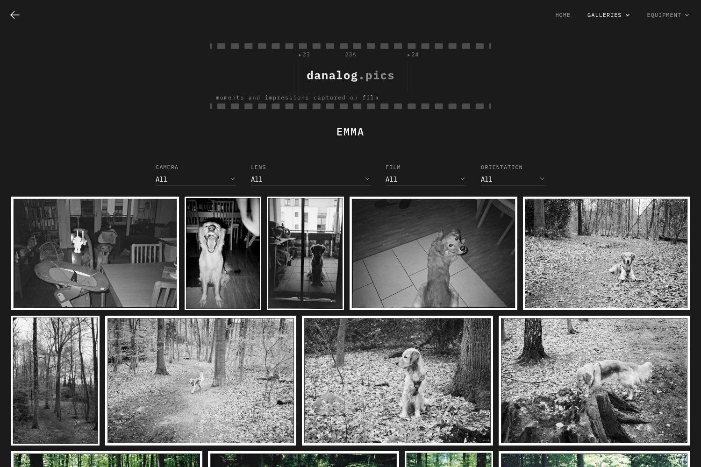

# Hugo Gallery Theme

A very simple and opinionated photo gallery theme for Hugo.

This is a fork of [nicokaiser/hugo-theme-gallery](https://github.com/nicokaiser/hugo-theme-gallery) by [Nico Kaiser](https://kaiser.me/), which has since diverged significantly and is no longer synced with upstream.

- [Demo](https://czerwonk.github.io/danalog-hugo-theme/) (the example site, with generated placeholder images)
- [Example site source](https://github.com/czerwonk/danalog-hugo-theme/tree/main/exampleSite)

---



---

## Features

- Responsive design
- Dark color scheme (can be set per page)
- Private albums
- Justified album views with [Flickr's Justified Layout](https://github.com/flickr/justified-layout)
- Lightbox with [PhotoSwipe](https://photoswipe.com/)
- SEO with Open Graph tags
- Automatic (or manual) selection of feature/cover images

**Important note: do not try to use WebP images.** The golang WebP implementation used in Hugo has a bug which leads to wrong image levels (dull looking images) upon resize. See [nicokaiser/hugo-theme-gallery#102](https://github.com/nicokaiser/hugo-theme-gallery/issues/102) for more details.

### Additional features in this fork

- Configurable banner (logo) shown in the header, linking back to the home page, with custom dimensions
- Configurable favicon and apple-touch-icon paths
- EXIF-based camera/lens/film stock detection, with filterable `/cameras` and `/lenses` pages
- Configurable image borders/frames
- Fullscreen lightbox with mouse zoom and click-to-open
- Crossfade slideshow on album cover hover
- Multi-layer menu structure
- Recent uploads page and per-gallery RSS feeds
- Site-wide default sort order for all galleries

## Installation

This theme requires Hugo >= 0.168.0 and [Dart Sass](https://gohugo.io/functions/css/sass/#dart-sass) (the `sass` executable in your `PATH`, e.g. `dart-sass` in nixpkgs or `snap install dart-sass`). Other dependencies are bundled, so no Node.js/NPM and PostCSS is needed.

### As a Hugo Module

Requires the Go binary installed.

```sh
hugo mod init github.com/<your_user>/<your_project>
```

Then add the theme to your `hugo.toml`:

```toml
[module]
  [[module.imports]]
    path = "github.com/czerwonk/danalog-hugo-theme/v4"
```

### As Git Submodule

```sh
git submodule add --depth=1 https://github.com/czerwonk/danalog-hugo-theme.git themes/gallery
```

## Usage

Page bundles which contain at least one image are listed as album or gallery:

```plain
content/
├── _index.md
├── about.md             <-- not listed in album list
├── animals/
│   ├── _index.md
│   ├── cats/
│   |   ├── index.md
│   |   ├── cat1.jpg
│   |   └── feature.jpg  <-- album cover
│   ├── dogs/
│   |   ├── index.md
│   |   ├── dog1.jpg     <-- album cover
│   |   └── dog2.jpg
│   └── feature.jpg
├── bridge.jpg           <-- site thumbnail (OpenGraph, etc.)
└── nature/
    ├── index.md         <-- contains `cover: true` for `tree.jpg`
    ├── nature1.jpg
    ├── nature2.jpg
    └── tree.jpg         <-- album thumbnail
```

- `/about.md` is not a Page Bundle and does not have image resources. It is not displayed in the album list.
- `/nature` is a Leaf Bundle (has `index.md` and no children) => displayed as gallery (`single` layout).
- `/animals` is a Branch Bundle (has `_index.md` and has children) => displayed as album list (`list` layout).
- The image resource with `*feature*` in its name or the first image found is used as thumbnail image for album lists.
- Albums without an image are not shown.

### Front matter

- `title` -- title of the album, shown in the album list and on the album page.
- `date` -- album date, used for sorting (newest first).
- `description` -- description shown on the album page. Rendered as markdown to enable adding links and some formatting.
- `weight` -- can be used to adjust sort order.
- `params.featured_image` -- name of the image file used for the album thumbnail. If not set, the first image which contains `feature` in its filename is used, otherwise the first image in the album. (Deprecated, use `resources.params.cover`)
- `params.private` -- if set to `true`, this album is not shown in the album overview, on equipment and recent pages, in the sitemap and in RSS feeds, and is marked `noindex`. It is still published: anyone with the link can open it, so this is not access control.
- `params.featured` -- if set to `true`, this album is featured on the homepage (even if private).
- `params.sort_by` -- property used for sorting images in an album. Default is `Name` (filename), but can also be `Date` (from EXIF/IPTC/XMP metadata, see [Image Metadata](#image-metadata)). Overrides the site-wide `params.gallery.sortBy` configuration.
- `params.sort_order` -- sort order. Default is `asc`. Overrides the site-wide `params.gallery.sortOrder` configuration.
- `params.theme` -- color theme for this page. Defaults to `defaultTheme` from configuration.

### Album Cover

By default, the cover image of an album is the first image in its folder. To select a specific image (which must be part of the album), use the `cover` resource parameter in the front matter:

```plain
---
title: Nature
resources:
  - src: tree.jpg
    params:
      cover: true
---
```

You can hide images from the gallery and use them only as cover image:

```plain
---
title: Nature
resources:
  - src: nature-cover.jpg
    params:
      cover: true
      hidden: true
---
```

### Image Metadata

Image titles for the lightbox view are either taken from the `ImageDescription` EXIF tag, or the `title` in the resource metadata.

EXIF tags can be written using software like Adobe Lightroom or by using command line tools like exiftool:

```sh
exiftool -ImageDescription="A closeup of a gray cat's face" cat-4.jpg
```

The theme reads these EXIF fields:

| Field                   | Used for                                |
| ----------------------- | --------------------------------------- |
| `DateTimeOriginal`      | sorting by `Date`                       |
| `ImageDescription`      | image titles                            |
| `Make`, `Model`         | camera (captions, filter, `/cameras`)   |
| `LensMake`, `LensModel` | lens (captions, filter, `/lenses`)      |
| `UserComment`           | film stock (captions, filter, `/films`) |

Hugo's default `imaging.meta.fields` includes all of them. If your site sets its own list, it must contain these fields. A theme cannot provide this setting, as Hugo does not merge `imaging` from themes:

```toml
[imaging.meta]
  sources = ["exif"]
  fields = ["DateTimeOriginal", "ImageDescription", "Make", "Model", "UserComment", "LensMake", "LensModel"]
```

#### Camera, lens and film without EXIF

Scans often have no EXIF data. Camera, lens and film can then be set as resource params in the album's front matter: per photo, or for all photos with a glob. They are used wherever EXIF would be (captions, copy button, filter, equipment pages), only for values missing in the EXIF data, which always wins. Hugo applies matching entries in order and later ones win, so put the album-wide entry first:

```yaml
---
title: Harbour
resources:
  - src: "*.jpg"
    params:
      camera: Leica M2
      lens: ZEISS Biogon T* 35mm f/2 ZM
      film: Kodak Portra 400
  - src: harbour-07.jpg # the last frames of the roll were shot on another film
    params:
      film: Ilford HP5
---
```

Equipment pages match these values exactly, like EXIF values: the `params.camera`, `params.lens` or `params.film` of a page in `content/cameras/`, `content/lenses/` or `content/films/` (or its title) must equal the value.

Alternatively, the image title can be set in the front matter:

```plain
---
date: 2024-02-18T14:12:44+0100
title: Cats
resources:
  - src: cat-1.jpg
    title: Brown tabby cat on white stairs
    params:
      date: 2024-02-18T13:04:30+0100
  - src: cat-4.jpg
    title: A closeup of a gray cat's face
---
```

This also enables custom ordering:

```plain
---
sort_by: Params.weight
resources:
  - src: image-1.jpg
    params:
      weight: 20
  - src: image-2.jpg
    params:
      weight: 10
---
```

### Categories

If you use categories in your albums, the homepage displays a list of categories.
Make sure `term` is not included in `disableKinds` in the site config.

content/dogs/index.md:

```plain
---
date: 2023-01-12
title: Dogs
categories: ["animals", "nature"]
resources:
  - src: dogs-title-image.jpg
    params:
      cover: true
---
```

Categories can also have custom titles and descriptions (by default, the "animals" category will have "Animals" as title and no description). Just create a `content/categories/<category>/_index.md`:

content/categories/animals/\_index.md:

```plain
---
title: Cute Animals
description: This is the description text of the "animals" category.
---
```

#### List of Categories

To enable a list of categories, each category must at least have an image in the `content/categories/<category>/` folder. Also, `taxonomy` must _not_ be included in the `disableKinds` in the site config.

Then, `/categories` displays a list of categories, with their cover image.

#### Other Taxonomies

You can also use other taxonomies like `series`. Note that only `categories` and `tags` are enabled by Hugo's default settings. Using `series` as additional taxonomy is left as an exercise for the reader.

### Featured Content on the Homepage

Albums (and also taxonomy pages like categories) can be marked as "featured":

```plain
---
title: Featured Album
params:
  featured: true
---
```

When used in combination with `private: true` this album is only shown as featured album on the homepage, and not in any album list.

Note that also categories or any other taxonomy term can be marked as featured, so you can feature a whole category, series, etc.

By default, the homepage displays

- the site title,
- links to all categories (if categories are enabled and used)
- the most recent featured content (even if private)
- all non-private top-level albums

This can easily be adjusted by using a local version of `layouts/_default/home.html`.

### Related Content

If related content is available for your site (e.g. when keywords or tags are used), related albums are shown below each gallery. Read more about this in the [Hugo Docs](https://gohugo.io/content-management/related/#configure-related-content).

Here is an example section in `config/_default/hugo.toml` to enable related content:

```toml
[related]
  includeNewer = true
  threshold = 10
  toLower = false
  [[related.indices]]
    applyFilter = false
    cardinalityThreshold = 0
    name = 'categories'
    pattern = ''
    toLower = false
    type = 'basic'
    weight = 10
  [[related.indices]]
    applyFilter = false
    cardinalityThreshold = 0
    name = 'keywords'
    pattern = ''
    toLower = false
    type = 'basic'
    weight = 50
```

### Social Icons

Use the `socialIcons` configuration key to add social icons on the bottom of each page:

```toml
[params]
  ...
  [params.socialIcons]
    facebook = "https://www.facebook.com/"
    instagram = "https://www.instagram.com/"
    github = "https://github.com/nicokaiser/hugo-theme-gallery/"
    youtube = "https://www.youtube.com/"
    email = "mailto:user@example.com"
    linkedin = "https://linkedin.com/"
```

### Exclude original photos

To exclude the original photos from the published site, and to disable the "Download" button, you can use the `build.publishResources` configuration option. Either add it to a specific album, or use `cascade` to omit the originals from all sub-albums. With `publishResources: false` only the resized images (without any metadata) are included in the published site, which can save quite some disk space.

```toml
cascade:
  build:
    publishResources: false
```

### Custom CSS

CSS is generated with Hugo Pipes, so you can add additional CSS in `assets/css/custom.css` (see example in `exampleSite`).

The theme exposes these CSS variables:

| Variable                 | Default                      | Purpose                                                              |
| ------------------------ | ---------------------------- | -------------------------------------------------------------------- |
| `--radius`               | `0`                          | Corner radius of photos                                              |
| `--card-fit`             | `cover`                      | `object-fit` of album card images; `contain` keeps borders uncropped |
| `--card-placeholder`     | the image's placeholder      | Card background while loading; set `transparent` with `contain`      |
| `--font-display`         | system sans-serif            | Page, album, featured and lightbox titles, menu entries              |
| `--font-display-weight`  | `600`                        | Weight of those titles; match a weight your font files provide       |
| `--font-meta`            | system monospace             | Metadata labels (photo counts, EXIF captions)                        |
| `--font-body`            | system sans-serif            | Running text (descriptions, prose pages)                             |
| `--card-title-size`      | `1.125rem`                   | Album card titles                                                    |
| `--page-title-font`      | `var(--font-display)`        | Page title (`h1`)                                                    |
| `--page-title-weight`    | `var(--font-display-weight)` | Weight of the page title                                             |
| `--page-title-size`      | fluid `2rem`–`3rem`          | Size of the page title                                               |
| `--page-title-tracking`  | `normal`                     | `letter-spacing` of the page title                                   |
| `--page-title-transform` | `none`                       | `text-transform` of the page title, e.g. `uppercase`                 |

```css
:root {
  --card-fit: contain;
  --card-placeholder: transparent;
  --font-meta: "Courier Prime", monospace;
}
```

If images get a border (`borderSize > 0`), the border color is used as loading placeholder, otherwise the image's dominant color.

Texts like the photo count come from `i18n/`; a site can override them with its own `i18n/en.yaml`, e.g. to count frames instead of photos:

```yaml
photoCount:
  one: 1 frame
  other: "{{ . }} frames"
```

### Gallery Filter

Galleries (albums, the recent page and equipment pages) get a filter bar: one line with camera, lens, film (`UserComment`) and orientation, always in this order, built from the photos' EXIF data (or front matter, see [Camera, lens and film without EXIF](#camera-lens-and-film-without-exif)). Each field is an icon followed by either the value all photos share (static info) or a dropdown for values that differ, so a camera page shows its camera and offers filters for the rest. On phones the fields wrap into two columns. Orientation is offered alongside gear info, never on its own; galleries without camera, lens or film data show no filter bar. Filters combine; each option shows how many photos remain and is disabled if none would. The active filter is kept in the URL (e.g. `?film=kodak-portra-400`), so filtered views can be shared; the lightbox only steps through the filtered photos. Without JavaScript the filter bar stays hidden.

### Caption Icons

The lightbox and the filter bar show camera, film (`UserComment`) and lens with icons from `assets/icons/camera.svg`, `film.svg` and `lens.svg`; the filter bar also uses `orientation.svg`. To replace an icon, put an SVG with the same name into your site's `assets/icons/`. Use `currentColor` for strokes or fills so the icon follows the caption color.

The lightbox toolbar has a copy button that puts camera, film and lens on the clipboard as plain text with emojis, ready to paste into social media posts:

```text
📷 Leica M2
🎞️ Kodak Portra 400
🔘 Leica Summicron 50mm f/2
```

The button is hidden for photos without this information and on sites served without HTTPS (the Clipboard API requires a secure context; `localhost` works).

### Custom JavaScript

You can add additional JavaScript in `assets/js/custom.js`.

## Development

`npm test` (or `tests/run.sh`) runs the JavaScript unit tests and builds the fixture site in `tests/site` to check the generated HTML and CSS. Requires Hugo, Dart Sass and Node.js.

Third-party libraries (PhotoSwipe and its dynamic caption plugin) are vendored into `assets/`, so sites build without Node.js. Their versions are pinned in `package.json` (`dependencies`), which Dependabot monitors. After changing a version, run `npm install && npm run vendor` and commit the updated files; CI (`npm run vendor -- --check`) fails while they differ.

## Author

- [Nico Kaiser](https://kaiser.me/) (original [hugo-theme-gallery](https://github.com/nicokaiser/hugo-theme-gallery))
- [Daniel Brendgen-Czerwonk](https://github.com/czerwonk) (this fork)
